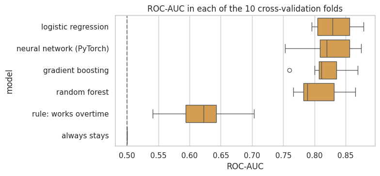
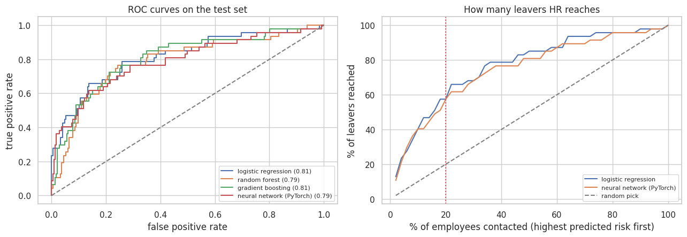
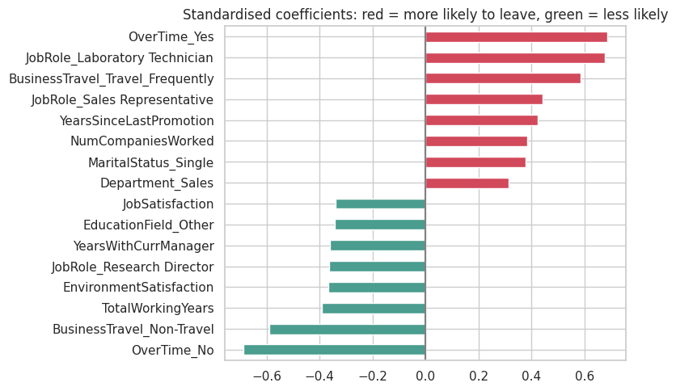
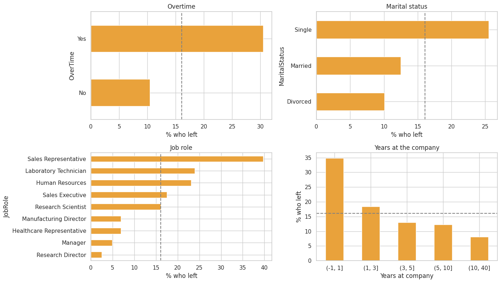

# Employee attrition: can a neural network beat simple models?

Predicting which employees are likely to leave, so that HR can talk to them first, and finding out whether a **PyTorch neural network**
adds anything over simpler models.

> **The data is fictional.** It is the *IBM HR Analytics Employee Attrition & Performance* dataset (1,470 employees, 35 columns, 16.1 %
> of whom left), created by IBM data scientists. The results show how the methods behave, not what real employees do. A model like this
> should prioritise supportive conversations, never penalise people.

## Main findings

- **The accuracy of the first version hid a collapsed model.** Its recipe scores 86.7 %, exactly what answering "stays" gives, because it
  flags **nobody** (recall of the leavers 0 %, ROC-AUC 0.56).
- **Evaluated properly, simple models do as well as the network.** The neural network adds nothing over a logistic regression here.
- **The practical value is real:** contacting the 20 % of employees with the highest predicted risk reaches **57 % of the leavers** on the
  test set (27 of 47), against about 9 for a random pick.

| Model | ROC-AUC, cross-validation | ROC-AUC, test (95 % interval) | PR-AUC, test | Leavers reached in the top 20 %, test |
|---|---:|---:|---:|---:|
| Always "stays" | 0.50 | | 0.16 | 19 % (cross-validation) |
| Rule: works overtime | 0.62 | | | 34 % (cross-validation) |
| **Logistic regression** | **0.832** | **0.812** (0.74 - 0.88) | 0.588 | 57 % |
| **Neural network (PyTorch)** | 0.826 | 0.788 (0.70 - 0.86) | 0.548 | 57 % |
| Gradient boosting | 0.818 | 0.806 (0.73 - 0.87) | 0.493 | 55 % |
| Random forest | 0.805 | 0.787 (0.71 - 0.86) | 0.439 | 57 % |

Cross-validation: repeated stratified 5-fold (10 folds) on the training set. Test: 294 employees, 47 of whom left, used **once**.
On the test set the network is 0.024 behind the logistic regression, but the paired bootstrap interval (-0.055 to +0.006) includes zero.





## What drives attrition

Overtime, frequent business travel, the laboratory-technician and sales-representative roles, more companies worked for and more time
since the last promotion go with leaving. No business travel, more years of total experience, satisfaction with the environment and more
years with the current manager go with staying.





## What I changed from my first version

The first version preprocessed the **whole** dataset (outlier capping, min-max scaling, label encoding), split at random and trained a
`Softmax` network with `NLLLoss` and SGD, reporting only the accuracy. Re-created from its code, it scores 86.7 % accuracy while flagging
nobody. This version:

- splits **first** (stratified) and fits every scaler and encoder on the training data only;
- ends the network in a single logit trained with `BCEWithLogitsLoss` (a `Softmax` followed by `NLLLoss` is a mismatch: `NLLLoss`
  expects log-probabilities), weights the rare class, uses Adam with weight decay and **early stopping**;
- judges the models by **ROC-AUC, PR-AUC and the share of leavers reached in the top 20 %**, not by accuracy;
- compares the network with a baseline, a one-feature rule, a logistic regression and two tree models, by repeated cross-validation,
  and checks the final difference with a bootstrap;
- drops the three constant columns and the employee id, and one-hot encodes the categories (the first version label-encoded nominal
  columns such as the marital status, which imposes an order that does not exist).

## Limitations

- A fictional dataset; the findings describe the methods, not real employees.
- Associations, not causes.
- The test set has only 47 leavers, so the intervals are wide.
- The network was not tuned beyond a sensible default.
- The re-creation of the first version includes my reconstruction of how two columns (`BusinessTravel`, `Department`) were encoded.

## Run it

```bash
pip install -r requirements.txt
# put the data in data/  (see data/README.md)
jupyter notebook Employee_attrition_prediction.ipynb
```
